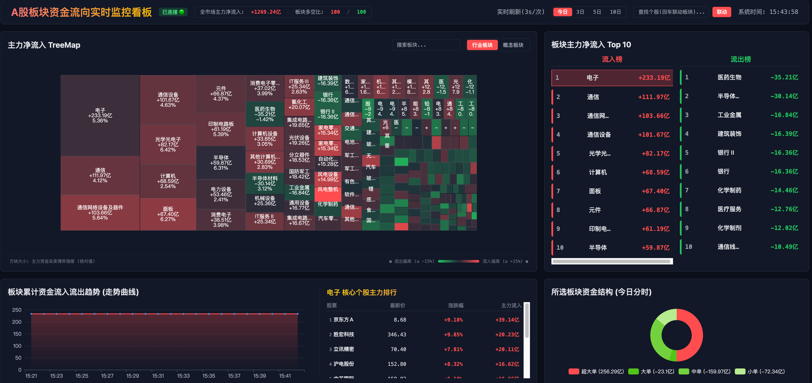

# A-Share Capital Flow Dashboard (A股板块资金流向实时监控看板)



A-Share Capital Flow Dashboard 是一款面向 A 股市场的**专业级实时资金流向监控看板**。系统基于 FastAPI + Vue 3 + ECharts 5 架构，采用科技暗黑风视觉设计，支持全市场行业/概念板块资金流的实时高频刷新、多周期历史趋势切换、TreeMap 交互式热力图、板块核心个股 Top 50 深度浏览、个股反向联动板块检索、以及个股分时/日K与五档单资金明细弹窗等功能，为投资者提供全景式的资金流向监控座舱。

---

## 🌟 核心特性

- ⚡ **3秒高频实时刷新**：后端对东方财富 API 的主动请求频率固定为 3秒一次，保障数据高灵敏度，并通过 50ms 串行间隔设计规避 CDN WAF 并发限制。
- 🔗 **高效连接池复用与 IPv4 强制解析**：利用 `httpx.AsyncClient` 维护持久连接，显式关闭 HTTP/2 防止 ALPN 握手被拒；结合全局 DNS 拦截补丁（强制 `eastmoney.com` 使用 IPv4 / `AF_INET` 解析），彻底根除国内部分宽带下 IPv6 CDN 握手空回复（Empty reply）导致的请求超时黑洞。
- 📊 **交互式资金热力图 (TreeMap)**：面积映射主力博弈强度（资金绝对值），颜色深浅呈现净流入比率；支持 Roam 滚轮平滑缩放与拖拽，并支持双击任意空白区域一键重置视角。
- ⏱️ **多周期流向切换**：看板支持「今日分时、3日、5日、10日」4 档流向周期一键切换；今日周期实时读取 WebSocket 增量内存曲线，多日周期自动获取 30 日日 K 线历史主力资金流向进行走势绘制。
- 🏆 **板块核心个股主力排行 (Top 50)**：单击任意板块即可获取该板块内主力资金净流入前 50 只核心成分股；支持双位序号工整对齐与纵向平滑滚动，并配备 30 秒内存 TTL 缓存与过期键自动淘汰机制。
- 📈 **个股深度盘口弹窗 (分时 / 日K / 五档单结构)**：在排行榜或核心个股列表中点击任意个股，即可唤起深度弹窗；支持分时均价线（含昨收对比基准与双 Y 轴涨跌幅）、120日前复权日 K 线（蜡烛图 + 成交量 + 滚轮缩放），以及超大单/大单/中单/小单主力博弈结构明细。
- 🔍 **个股反向联动板块检索**：在搜索框输入任意 A 股代码或拼音/名称（如 `000725` 或 `京东方A`），系统自动解析该股所属行业及活跃概念题材，自动切换 Tab 标签并高亮选中目标板块，联动拉取对应成分股列表与走势曲线。
- 🛡️ **内存与资源安全**：前后端均严格管理连接及定时器生命周期。前端组件卸载及弹窗关闭时彻底注销 ECharts 实例并清除定时器，后端退出时优雅关闭 HTTP 客户端，绝无死锁与内存泄露风险。
- 🧪 **100% 离线测试覆盖**：编写了 26 个高覆盖率的单元测试，支持 100% 离线 mock 运行，测试执行后自动恢复全局状态，保证开发与 CI/CD 流程持续稳定。

---

## 🛠️ 技术栈

### 后端 (Backend)
- **Python 3.10+**
- **FastAPI** (高性能异步 Web 框架)
- **Uvicorn** (ASGI 服务器)
- **HTTPX** (支持异步和连接池复用的 HTTP 客户端)
- **Pytest** + **Pytest-Asyncio** (异步测试框架)

### 前端 (Frontend)
- **Vue 3** (Composition API, `<script setup>` 响应式开发)
- **ECharts 5** (高性能图表引擎，驱动 TreeMap、分时/历史趋势图、资金结构饼图、个股分时及日K线图)
- **Tailwind CSS 3** (原子化 CSS 框架，定制极客暗黑主题)
- **Vite 4** (下一代前端构建工具)

---

## 🖥️ 界面功能布局

| 区域 | 功能组件 | 说明 |
| :--- | :--- | :--- |
| **顶部状态栏** | 全市场大盘指标 | 实时显示系统运行时间、WebSocket 连接状态、全市场主力净流入总额及板块多空比（上涨/下跌板块数） |
| | 多周期切换器 | 支持 `今日` / `3日` / `5日` / `10日` 资金流向周期即时切换 |
| | 个股反向联动输入框 | 支持输入代码或名称回车，一键反查板块并定位 |
| **左侧上部** | 主力净流入 TreeMap | 支持行业/概念分类切换、关键词过滤、滚轮缩放、拖拽与双击复位 |
| **左侧下部** | 资金趋势走势折线图 | 展现所选板块分时增量或多日累计资金流入/流出趋势曲线（红涨绿跌基准线） |
| | 核心个股主力排行 (Top 50) | 展示所选板块内主力流入前 50 只个股（最新价、涨跌幅、主力净流入），点击直达个股弹窗 |
| **右侧上部** | 板块主力排行榜 | 双排展示流入榜 Top 10 与流出榜 Top 10，带有位次平滑过渡动画，点击切换关注板块 |
| **右侧下部** | 板块资金结构饼图 | 实时展示所选板块内超大单、大单、中单、小单资金流入流出比例 |
| **全局浮层** | 个股深度分析弹窗 | 包含分时线（现价/均价/昨收线/双轴涨跌幅）、120日K线、成交量及五档单分类统计卡片，支持 `ESC` 键快捷退出 |

---

## 🔌 API 接口规范

系统提供高效 RESTful 接口与 WebSocket 实时广播协议：

### 1. WebSocket 实时通道
- **`WS /ws/capital-flow`**
  - **频率**：3秒/次主动广播
  - **心跳**：服务端每 10 秒下发 `{"type": "ping"}`，客户端回发 `{"type": "pong"}`
  - **推送载荷**：全市场行业与概念板块最新行情快照及分时更新时间戳

### 2. 板块数据接口
- **`GET /api/sectors/history`**：获取所有板块开盘以来的日内分时主力资金缓存
- **`GET /api/sectors/history/{code}?period=1|daily`**：获取指定板块的历史走势数据（`period=1` 为日内分时，`period=daily` 为近 30 个交易日日 K 资金走势）
- **`GET /api/sectors/{code}/stocks?limit=50`**：获取指定板块的核心个股主力资金流入排行榜（默认 50 只，支持 30 秒内存 TTL 缓存）

### 3. 个股与反向联动接口
- **`GET /api/stocks/search?q={query}`**：反查股票（支持代码或中文名），返回其所属行业及活跃概念板块
- **`GET /api/stocks/{code}/intraday`**：获取指定个股今日分时走势（现价、均价、成交量）与今日超大/大/中/小单累计明细
- **`GET /api/stocks/{code}/kline`**：获取指定个股近 120 个交易日前复权日 K 线（高开低收、成交量）

---

## 📁 目录结构

```text
├── backend/
│   ├── app/
│   │   ├── main.py          # FastAPI 路由入口、静态托管、API 接口与 TTL 缓存防刷
│   │   ├── scheduler.py     # 异步后台调度器（CST时区、重试、WAF绕过、IPv4强制解析）
│   │   ├── manager.py       # WebSocket 连接池管理器（支持主动 ping/pong 心跳）
│   │   └── config.py        # 全局静态配置文件（TTL、API 镜像、轮询周期）
│   ├── tests/
│   │   ├── test_main.py     # 路由及 WebSocket 逻辑单元测试
│   │   ├── test_manager.py  # WebSocket 管理器及心跳测试
│   │   ├── test_scheduler.py# 后台数据拉取及缓存管理测试
│   │   └── test_search.py   # 个股检索、特殊字符及 mock 测试
│   └── requirements.txt     # 后端依赖列表
│
├── frontend/
│   ├── src/
│   │   ├── App.vue          # 前端主页面（看板布局、WS 通信、排行榜动画、个股弹窗）
│   │   ├── charts.js        # ECharts 统一驱动引擎（TreeMap、分时/历史走势、饼图、K线）
│   │   └── main.js          # Vue 入口文件
│   ├── package.json         # 前端依赖及构建脚本
│   └── tailwind.config.js   # Tailwind 主题及极客暗黑色彩配置
│
├── docs/                    # 规格设计与实施计划文档
└── run.sh                   # 一键启动脚本
```

---

## 🚀 快速开始

### 1. 克隆项目
```bash
git clone <your-repo-url>
cd stock
```

### 2. 后端配置与环境准备
推荐使用虚拟环境安装后端依赖：
```bash
# 创建虚拟环境
python3 -m venv .venv
source .venv/bin/activate

# 安装依赖
pip install -r backend/requirements.txt
```

### 3. 前端依赖安装与构建
进入前端目录安装依赖，并构建生产静态资源：
```bash
cd frontend
npm install
npm run build
cd ..
```
构建完成后，Vite 会在 `frontend/dist` 目录下生成静态文件，FastAPI 启动时会自动将其挂载并进行一体化托管。

### 4. 一键启动系统
在项目根目录下，直接执行启动脚本：
```bash
bash run.sh
```
启动成功后，在浏览器中访问：**[http://localhost:8080](http://localhost:8080)**

---

## 🧪 运行测试套件

系统包含了严密的离线测试套件（覆盖网络降级、异常防御、缓存淘汰、个股检索、K线计算等）：
```bash
PYTHONPATH=backend .venv/bin/pytest backend/tests/ -v
```
所有测试均使用 Mock 机制，支持 100% 离线脱网执行，单次全套运行仅需约 0.8 秒，充分保障工程健壮性。

---

## 📄 开源协议

本项目基于 [MIT License](LICENSE) 协议开源。欢迎提交 Issue 和 Pull Request 进行交流与共同建设。
