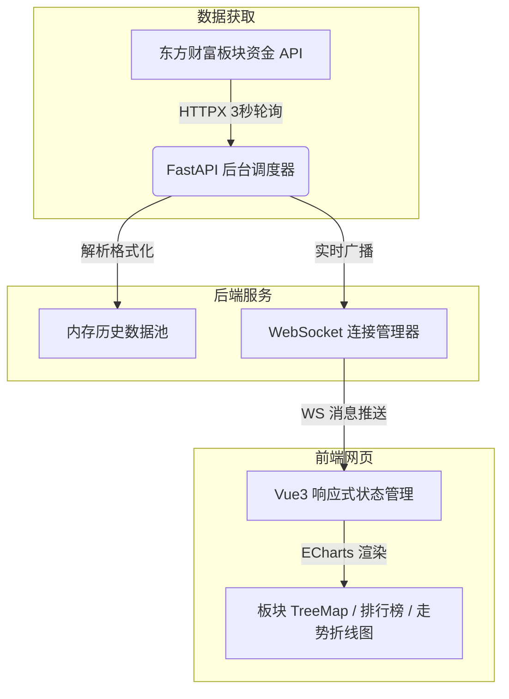

# A股板块资金流向实时看板系统设计规约 (Spec)

本设计规约明确了 A 股板块实时资金流向网页看板系统的技术方案与业务逻辑。

---

## 1. 业务目标与核心需求

### 1.1 系统目标
构建一个能够低延迟展示 A 股各个板块（行业板块、概念板块）实时资金流入流出情况的网页看板。支持高对比度科技暗黑风，适合大屏监控及直播（OBS 捕获）场景。

### 1.2 核心展示指标
1. **主力资金净流入**：超大单流入额 + 大单流入额 - 超大单流出额 - 大单流出额。
2. **板块热力图 (TreeMap)**：面积表示板块成交量级，颜色深浅表示主力资金流入/流出强度。
3. **资金红绿双榜 (Top 10)**：实时滚动展示资金净流入与净流出最明显的板块。
4. **历史资金走势曲线 (Line Chart)**：绘制今日开盘以来主力资金的累计流向趋势。
5. **资金层级结构 (Pie/Radar)**：拆解当前选定板块的超大单、大单、中单、小单流向比例。

---

## 2. 系统技术架构

本系统采用**轻量级前后端分离 + 单进程混合部署方案**：



### 2.1 后端技术栈
* **核心框架**：Python `FastAPI` (100% 异步支持)
* **网络请求**：`httpx` (异步 HTTP 库)
* **运行服务器**：`uvicorn`

### 2.2 前端技术栈
* **核心框架**：`Vue 3` (组合式 API) + `Vite`
* **样式系统**：`TailwindCSS`
* **可视化引擎**：`ECharts` (TreeMap, Line, Pie 模块)

---

## 3. 数据层与接口设计

### 3.1 东方财富外部数据源 API
后端抓取两个核心接口：
1. **行业板块资金流向接口**：
   * **URL**: `https://push2.eastmoney.com/api/qt/clist/get`
   * **参数**: `fs=m:90+t:2`
2. **概念板块资金流向接口**：
   * **URL**: `https://push2.eastmoney.com/api/qt/clist/get`
   * **参数**: `fs=m:90+t:3`

**抓取关键字段映射**：
* `f12`: 板块代码 (如 `BK0437`)
* `f14`: 板块名称
* `f3`: 板块涨跌幅 (%)
* `f62`: 当日主力净流入额 (超大单 + 大单累计值，单位：元)
* `f66`: 当日超大单净流入额
* `f72`: 当日大单净流入额
* `f78`: 当日中单净流入额
* `f84`: 当日小单净流入额

### 3.2 系统内部 API

#### REST API (HTTP)
* **`GET /api/sectors/history`**
  * **描述**：首次打开网页时，前端拉取开盘以来全天各板块的主力资金历史走势，使图表不会因刚建立 WS 连接而空白。
  * **返回格式**：
    ```json
    {
      "code": 200,
      "data": {
        "BK0437": {
          "timestamps": ["09:30", "09:33", "09:36"],
          "values": [0.0, 1.25, 2.50]
        }
      }
    }
    ```

#### WebSocket 实时推送
* **地址**：`ws://localhost:8000/ws/capital-flow`
* **心跳协议**：
  * 后端每 10 秒发送：`{"type": "ping"}`
  * 客户端必须回复：`{"type": "pong"}`
* **广播数据结构 (Payload)**：
  ```json
  {
    "type": "flow_update",
    "timestamp": "09:33:00",
    "data": {
      "industry": [
        {
          "code": "BK0437",
          "name": "半导体",
          "change_pct": 2.45,
          "main_net_inflow": 12.35,
          "super_large_inflow": 8.10,
          "large_inflow": 4.25,
          "medium_inflow": -2.15,
          "small_inflow": -10.20
        }
      ],
      "concept": []
    }
  }
  ```

---

## 4. 前端 UI 与可视化设计

### 4.1 视觉规范
* **背景色**：`#0B0F19` (暗海蓝) / `#121827` (面板灰)
* **上涨/流入色**：`#FF4D4F` (高饱和霓虹红)
* **下跌/流出色**：`#22C55E` (明亮极光绿)
* **布局比例**：固定 16:9 标准尺寸，隐藏横向/纵向滚动条，方便 OBS 采集。

### 4.2 核心图表渲染规则
1. **TreeMap 规则**：
   * 节点大小由当日板块交易总额决定。
   * 节点颜色根据 `主力净流入/成交总额` 比例渐变：
     * $> 5\%$ 映射到深红。
     * $0\%$ 映射到浅灰。
     * $< -5\%$ 映射到深绿。
2. **折线图规则**：
   * X 轴时间刻度固定显示：`09:30`, `10:30`, `11:30/13:00`, `14:00`, `15:00`。
   * 曲线下方采用红绿渐变半透明填充。
3. **排行榜动画**：
   * 使用 Vue 3 的 `<TransitionGroup>`，当板块净流入排名发生变换时，页面卡片条目平滑滑动。

---

## 5. 可靠性与性能优化

1. **源限流保护**：
   * 后端仅有单个后台协程每 3 秒访问一次东财 API，前端页面数量不影响东财 API 的访问频率。
2. **前端连接容错**：
   * 具备断开重连逻辑。网络断开时显示状态警报，重连时使用 1s、2s、4s、8s 指数退避算法。
3. **数据更新平滑化**：
   * 采用 ECharts 的动画平滑更新模式 (`notMerge = false`)，防止折线图和 TreeMap 发生突变式抖动。

---

## 6. 项目结构设计

```text
stock/
├── backend/
│   ├── app/
│   │   ├── __init__.py
│   │   ├── main.py
│   │   ├── config.py
│   │   ├── scheduler.py
│   │   └── manager.py
│   └── requirements.txt
├── frontend/
│   ├── src/
│   │   ├── components/
│   │   │   ├── Header.vue
│   │   │   ├── TreeMap.vue
│   │   │   ├── Ranking.vue
│   │   │   ├── LineChart.vue
│   │   │   └── PieChart.vue
│   │   ├── App.vue
│   │   └── main.js
│   ├── tailwind.config.js
│   ├── vite.config.js
│   └── package.json
└── README.md
```
