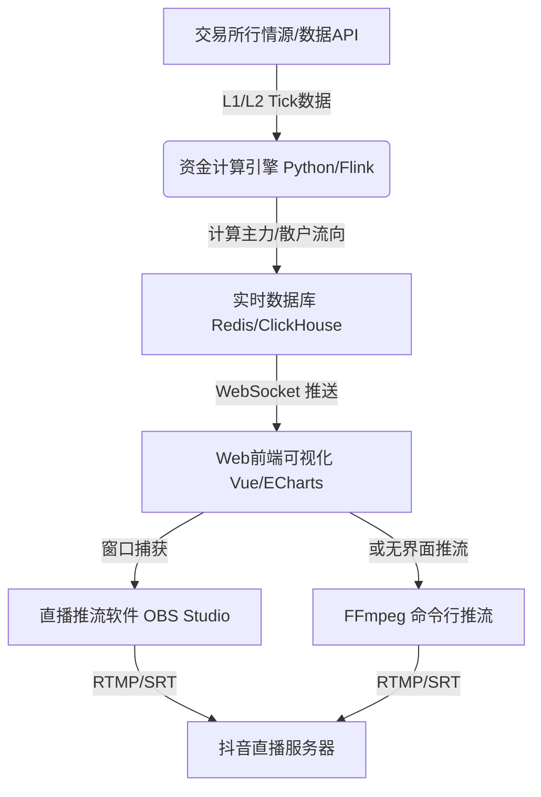

# A股资金流入流出实时统计直播系统深度分析报告

在抖音、视频号等直播平台上，经常能看到一些展示“A股大盘/个股资金实时流入流出”的直播间。这些直播间通常伴随着绿红交替的炫酷图表、实时滚动的交易大单、以及动态的资金曲线。

本报告将从**数据来源**、**计算算法**、**系统架构**、**直播推流**等多个技术维度，深度剖析这种实时资金统计直播的实现全貌。

---

## 1. 核心业务与技术架构

这类直播系统的核心运作流程可分为：**数据源接入 -> 资金流模型计算 -> 前端看板渲染 -> 视频流编码推流**。



---

## 2. 核心算法：资金流向是如何计算的？

直播间看到的“主力流入”、“超大单”、“净流入”等数据，核心依赖于 **Level-2（L2）逐笔成交数据** 的判定逻辑。

### 2.1 逐笔成交的方向判定（内盘与外盘）
每一笔股票成交都有主动买入和主动卖出之分：
*   **主动买入（外盘 / Buy）：** 买方以不低于当前**卖一**及以上的价格申报并成交，代表买方意愿迫切。这部分成交额计为**资金流入**（通常显示为红色）。
*   **主动卖出（内盘 / Sell）：** 卖方以不高于当前**买一**及以下的价格申报并成交，代表卖方急于出货。这部分成交额计为**资金流出**（通常显示为绿色）。
*   **中性盘（Neutral）：** 盘中对倒、集合竞价或无法明确判定方向的成交，不计入净流入。

### 2.2 订单大小的分类（划分主力与散户）
行情软件或直播系统通常会根据**单笔成交金额**将资金划分为不同的量级（通常以固定阈值或因股而异的动态阈值划分）：

| 资金类型 | 单笔成交金额阈值 | 属性归属 |
| :--- | :--- | :--- |
| **超大单** | $> 100$ 万元（或 $> 20$ 万股） | 主力/机构资金 |
| **大单** | $20$ 万元 $\sim 100$ 万元（或 $4$ 万 $\sim 20$ 万股） | 主力/机构资金 |
| **中单** | $4$ 万元 $\sim 20$ 万元 | 游资/中产散户 |
| **小单** | $< 4$ 万元 | 普通散户 |

### 2.3 资金净流入计算公式
*   **某只股票的资金净流入：**
    $$\text{资金净流入} = \text{主动买入成交额} - \text{主动卖出成交额}$$
*   **主力资金净流入（直播间最常展示的核心指标）：**
    $$\text{主力净流入} = (\text{超大单买入额} + \text{大单买入额}) - (\text{超大单卖出额} + \text{大单卖出额})$$
*   **大盘整体主力资金流向：**
    将全市场所有个股（如沪深京三市5000+只股票）的实时主力净流入进行实时加总累加。

---

## 3. 实时数据获取渠道

做这样一套系统，实时稳定且低延迟的数据源是核心。目前市面上常见的获取渠道有以下几种：

### 3.1 免费渠道：抓取财经门户公开的 API
东方财富、新浪财经、同花顺等平台的网页端或APP端，为了实现页面数据的实时刷新，在后台提供了 HTTP 轮询接口或 WebSocket 链接。
*   **原理：** 通过抓包分析（如 F12 开发者工具）获取这些接口，利用 Python 编写脚本定期请求（如每 2-5 秒一次），拉取全市场的大盘主力资金数据。
*   **优缺点：** 成本为零，开发简单；但存在被封 IP 的风险，且数据通常有数秒的延迟，非最底层原始 Tick 数据。

### 3.2 量化交易接口：QMT / PTrade 终端 API
国内各大券商为高净值或量化交易客户免费提供的交易终端（如国金、华泰等支持 of QMT）。
*   **原理：** 电脑运行 QMT 客户端，开启极速极简模式，通过 Python 脚本本地调用其提供的 `xtquant` 库，直接获取原生交易所 L2 逐笔成交数据。
*   **优缺点：** 延迟极低（毫秒级），数据精准，完全免费（只需满足券商开户资金门槛）；但需要本地挂载券商客户端，且有断线可能。

### 3.3 付费商业 API
使用 Tushare Pro、聚宽 (JoinQuant)、优矿 (UQuant) 或同花顺/东财的商业数据接口。
*   **优缺点：** 数据接口极其稳定，有专业售后；但按月/按年收费，且通常不支持毫秒级实时流式推送（多为分钟级或历史数据）。

---

## 4. 前端可视化与直播推流实现

拥有了实时数据后，如何将其变成抖音上看到的炫酷动态画面？

### 4.1 可视化看板开发
通常采用 Web 架构：
*   **后端：** Python (FastAPI/Flask) 或 Go / Node.js 接收数据源的推送，并使用 **Redis** 对实时数据进行缓存和每秒累计。通过 **WebSocket** 将最新的数据主动推给前端。
*   **前端：** Vue.js 或 React 框架，配合 **ECharts**、**Highcharts** 或直接使用 **HTML5 Canvas / WebGL** 绘制平滑波动曲线。
*   **特效设计：** 融入暗黑模式风格，使用发光霓虹特效（Css Filter Drop-shadow/Text-shadow），搭配数字翻页动画（CountUp.js），使界面具有科技感和视觉冲击力。

### 4.2 直播推流方案
有了炫酷网页，下一步就是将网页画面转为直播视频流推送给抖音。

#### 方案 A：OBS Studio 窗口捕获（最主流、最简单）
1.  在运行看板的电脑上打开 **OBS Studio**。
2.  新建“来源”，选择 **“浏览器”**（直接输入看板网页 URL）或 **“窗口采集”**（捕获本地浏览器页面）。
3.  在抖音上获取**直播推流地址（RTMP 地址 + 直播码）**。
4.  在 OBS 中设置流媒体参数，填入推流地址，点击“开始推流”。

#### 方案 B：无界面无 OBS 自动推流（适合 24 小时无人值守直播）
通过云服务器或后台脚本直接将页面转换为视频流进行推流，无需开启物理屏幕：
1.  使用 **Puppeteer (Headless Chrome)** 在云服务器后台无界面运行看板网页。
2.  利用 **Node.js** 或 **Python** 截取浏览器视口画面（以 30fps 的频率截图或使用 Puppeteer 视频流插件）。
3.  通过管道将图片数据流源源不断输入 **FFmpeg**。
4.  使用 FFmpeg 命令行将图片流实时转码为 H.264/AAC 视频流，并通过 RTMP 协议推送到抖音。
    ```bash
    ffmpeg -f image2pipe -framerate 30 -i pipe:0 -c:v libx264 -pix_fmt yuv420p -preset veryfast -g 60 -b:v 3000k -c:a aac -b:a 128k -f flv "rtmp://抖音推流地址/直播码"
    ```

---

## 5. 简易实现：使用 Python 抓取大盘资金实时数据示例

以下是一个简单的 Python 脚本示例，展示如何通过东方财富公开的接口，获取当前 A 股大盘的实时主力、超大单、大单等资金净流入数据：

```python
import time
import requests
import json

def get_market_capital_flow():
    # 东方财富大盘资金流向实时接口
    # 包含了今日主力、超大单、大单、中单、小单的实时净流入额与净流入占比
    url = "https://push2.eastmoney.com/api/qt/clist/get"
    params = {
        "pn": "1",
        "pz": "1",
        "po": "1",
        "np": "1",
        "ut": "b28861a683a54b19bf5112cdcd0d5bc2",
        "fltt": "2",
        "invt": "2",
        "fid": "f62",
        "fs": "m:90 t:1,m:90 t:2,m:90 t:3", # 代表上证、深证、创业板大盘
        "fields": "f12,f14,f62,f184,f66,f69,f72,f75,f78,f81,f84,f87"
    }
    
    headers = {
        "User-Agent": "Mozilla/5.0 (Macintosh; Intel Mac OS X 10_15_7) AppleWebKit/537.36 (KHTML, like Gecko) Chrome/120.0.0.0 Safari/537.36"
    }

    try:
        response = requests.get(url, params=params, headers=headers, timeout=5)
        data = response.json()
        
        diff = data.get("data", {}).get("diff", [])
        if not diff:
            print("未能获取到数据，可能处于非交易时间。")
            return
            
        market_data = diff[0]
        # 解析指标（单位通常为元，除以1亿转换为亿元）
        to_yicang = 100000000.0
        
        main_net_in = market_data.get("f62", 0) / to_yicang      # 今日主力净流入
        super_large_in = market_data.get("f66", 0) / to_yicang   # 超大单净流入
        large_in = market_data.get("f72", 0) / to_yicang         # 大单净流入
        medium_in = market_data.get("f78", 0) / to_yicang        # 中单净流入
        small_in = market_data.get("f84", 0) / to_yicang         # 小单净流入
        
        print("======== A股大盘实时资金流向 (单位: 亿元) ========")
        print(f"实时时间: {time.strftime('%Y-%m-%d %H:%M:%S', time.localtime())}")
        print(f"主力净流入: {main_net_in:+.2f} 亿 (超大单 + 大单)")
        print(f"  ├─ 超大单净流入: {super_large_in:+.2f} 亿")
        print(f"  └─ 大单净流入  : {large_in:+.2f} 亿")
        print(f"中单净流入: {medium_in:+.2f} 亿")
        print(f"小单净流入: {small_in:+.2f} 亿")
        print("==================================================")
        
    except Exception as e:
        print(f"请求失败: {e}")

if __name__ == "__main__":
    # 模拟实时刷新（每5秒获取一次）
    print("开始获取实时资金流向数据...")
    for _ in range(3):
        get_market_capital_flow()
        time.sleep(5)
```

> [!TIP]
> 很多抖音博主就是在此基础上，使用 Python 写好数据推送的 WebSocket，前端用 ECharts 的 `dataset` 动态更新 `series` 实现丝滑的大盘资金历史曲线绘制。
